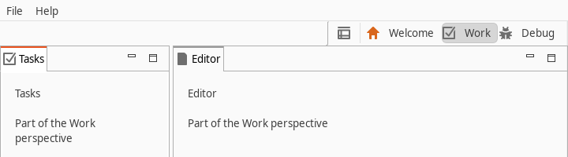

# Eclipse 4 Perspective Switcher

A perspective switcher tool control for Eclipse 4 RCP applications.
It shows a button per perspective of its window, a button that opens a perspective selection dialog, and a context menu to close a perspective or to show the perspective names next to their icons.

<p align="center">
  
</p>

## Installing

Add the update site

```
https://vogellacompany.github.io/e4-perspective-switcher/
```

to the target platform of your application and include the feature `org.eclipse.e4.ui.workbench.perspectiveswitcher.feature` in your product.
The site carries the newest build only; older versions are available as the repository zip attached to each GitHub release.

## Using it

Add a tool control to a trim bar of your application model with this contribution URI:

```
bundleclass://org.eclipse.e4.ui.workbench.perspectiveswitcher/org.eclipse.e4.ui.workbench.perspectiveswitcher.tools.PerspectiveSwitcherSwtTrim
```

The bundle contributes the command `org.eclipse.e4.ui.perspectives.showPerspective` through a model processor.
Without a parameter it opens the selection dialog; with `org.eclipse.e4.ui.perspectives.parameters.perspectiveId` it switches to that perspective.

`examples/com.sample.application` is a complete application that uses the switcher; launch `com.sample.application.product` from the Eclipse IDE to try it.

## Building

The build uses Maven 3.9.9 or newer, Java 25 and [Tycho](https://github.com/eclipse-tycho/tycho) in pomless mode:

```
mvn clean verify
```

The p2 repository ends up in `sites/org.eclipse.e4.ui.workbench.perspectiveswitcher.repository/target/repository`.
To work on the code in Eclipse, import the projects with *Search for nested projects* enabled and set `target-platform/perspectiveswitcher.target` as the active target platform.

Every push to `main` publishes to the update site; pushing a `v<version>` tag additionally creates a GitHub release with the repository zip.

## License

[Eclipse Public License 2.0](https://www.eclipse.org/legal/epl-2.0/), see [LICENSE.md](LICENSE.md).
